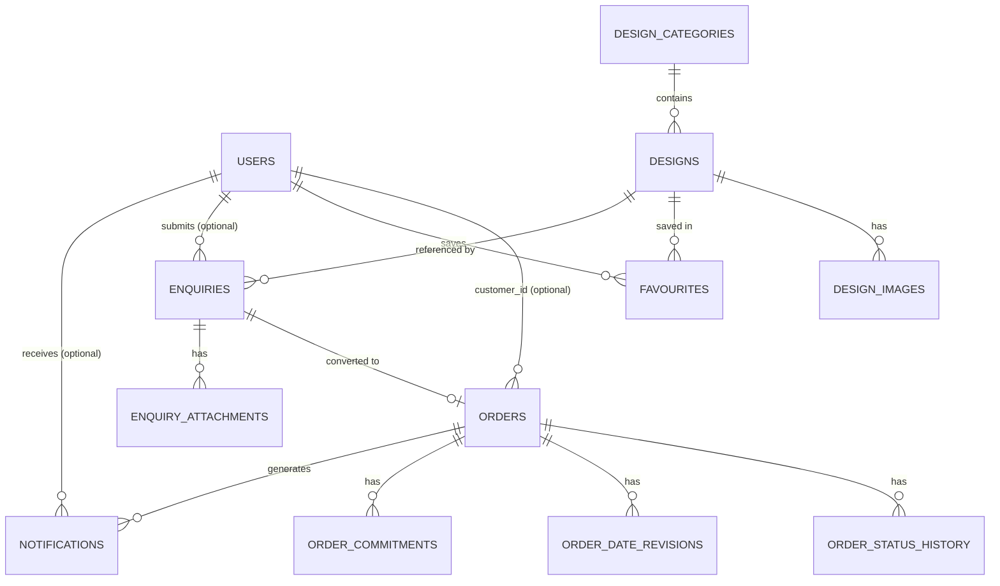

# Auspak Interior – Backend (FastAPI + PostgreSQL)

REST API for the Auspak Interior website: design gallery, enquiries with reference images, order management,
verified customer order tracking, delay/date-revision history, notifications (email / WhatsApp records) and an admin API.
The React frontend is built later and talks to this API. API base: `http://localhost:8000/api/v1`.

> **Status:** backend only. The existing React frontend in `../frontend` was written for the previous, simpler API
> (`/api/inquiries`, `/api/orders/track`, `/api/projects`). It must be updated to this API in the frontend phase.

## What problems this solves

| Customer problem | Backend feature |
|---|---|
| Cannot explore designs / completed work | Public gallery: categories, designs, several images each; admin controls publication |
| Cannot save favourites | Favourites (login required) |
| Cannot send requirements or reference photos | Enquiries (guests allowed) with up to 5 validated images, stored privately |
| Does not know order progress or expected date | Order tracking: order number + registered phone; stage timeline, dates, delay explanation |
| Not told about delays / revised dates | Delay flag with explanation, date revisions with reasons, notification records |
| Wants to ask about a specific order | Enquiry with `order_number` filled in |

## Required software
Python 3.11+, Docker Desktop (for PostgreSQL) or your own PostgreSQL 14+, VS Code. (Developed and tested on Python 3.12, PostgreSQL 16.)

## Setup (Windows PowerShell, from the project root `auspak-interior`)
```powershell
docker compose up -d                       # PostgreSQL on port 5432
cd backend
python -m venv venv
venv\Scripts\activate
pip install -r requirements.txt
copy .env.example .env
```
Open `backend\.env` and set **JWT_SECRET** (the app refuses to start without it). Generate one:
```powershell
python -c "import secrets; print(secrets.token_urlsafe(48))"
```
Then:
```powershell
alembic upgrade head                       # creates all tables
python -m app.seed                         # demo designs + 3 demo orders (no users)
python -m app.cli create-admin --email you@yourdomain.com --name "Your Name"   # asks for a password (hidden)
uvicorn app.main:app --reload --port 8000
```
* Swagger UI: http://localhost:8000/docs  (click **Authorize** and paste the `access_token` from `/auth/login`)
* Health: http://localhost:8000/api/v1/health
* Use a real-looking email domain: reserved ones such as `.test` and `.local` are rejected.

## Configuration (`backend/.env`)
| Variable | Meaning |
|---|---|
| `DATABASE_URL` | PostgreSQL connection (must match `docker-compose.yml`) |
| `JWT_SECRET` | **Required.** Random, 32+ characters. Never commit it |
| `ACCESS_TOKEN_EXPIRE_MINUTES` | Token lifetime (default 30) |
| `CORS_ORIGINS` | Frontend origins allowed to call the API |
| `STORAGE_DIR`, `MEDIA_URL` | Where images are stored; design images are served at `/media/...` |
| `DEFAULT_COUNTRY_CODE` | Used to turn `0300 1234567` into `+923001234567` (default `92`) |
| `EMAIL_PROVIDER` | `mock` (records only) or `smtp` |
| `SMTP_*`, `EMAIL_FROM` | SMTP settings, only when `EMAIL_PROVIDER=smtp` |
| `WHATSAPP_PROVIDER` | `mock` for now (see Notifications) |

## Tests
```powershell
docker exec -it auspak-postgres psql -U auspak -d auspak -c "CREATE DATABASE auspak_test;"   # once
pytest -q                                   # uses the separate auspak_test database
```
`pytest` rebuilds the `auspak_test` schema from the migrations and truncates it between tests; it never touches your development data.
Optional live check of a *running* server: `set ADMIN_EMAIL=...`, `set ADMIN_PASSWORD=...`, `python ..\qa\smoke_test.py`.

## Roles and permissions
| Function | Admin | Staff |
|---|---|---|
| Manage orders (create, edit, commitments) | Yes | Yes |
| Update order status, delay flag, revise dates | Yes | Yes |
| Manage customer enquiries (incl. reference images) | Yes | Yes |
| Send / retry order notifications | Yes | Yes |
| Dashboard | Full | Limited (order and enquiry counts only) |
| Manage gallery (designs, images) | Yes | **No** |
| Manage categories | Yes | **No** |
| Create staff accounts / manage admin accounts | Yes | **No** |
| Reopen completed orders | Yes | **No** |

Anonymous visitors: gallery, tracking, enquiries. Customers: favourites and their own notifications.
Public signup **always** creates a `customer`. Roles are read from the database on every request (never trusted from the token); disabling a user blocks them immediately.
An admin cannot change their own role or deactivate themselves, so the system always keeps at least one active admin.

## Order workflow
Stages: `order_received → designing → in_progress → ready_for_collection → completed`.
* Moving forward (including skipping a stage) is allowed; every change is written to `order_status_history` with who/when.
* Moving backward needs an explanation (10+ characters). Reopening a `completed` order is admin-only.
* **Delay is a separate flag**: an order can be `in_progress` *and* delayed. Marking delayed requires `delay_reason`; completing an order clears it.
* `agreed_completion_date` never changes. Changing the estimate (`/revise-date`) stores previous date, new date, reason and who.
* `PATCH /orders/{id}` cannot change status or dates, so those changes can never skip the history.
* Existing orders can be added at any stage; only one honest history entry is created (nothing is invented).
* Order numbers are random (`AUS-7K3F9QXM`), not sequential.
* An order can link to an enquiry (`enquiry_id`); the enquiry then becomes `converted`.

## Tracking security
`POST /tracking/lookup` needs order number **and** the phone on the order (any format; compared as `+92…`).
Wrong number, wrong phone, or both give the same generic 404. Limits: 10 attempts / 5 min per IP and 30 / hour per order number.
The response contains only customer-safe data (no internal IDs, staff, internal notes, customer contact details).
Phone matching is weaker than a one-time code: **add OTP (SMS/WhatsApp) before public launch.**

## Images
JPG/JPEG/PNG/WebP, 5 MB each; enquiries: max 5 images and 25 MB total. Files are checked by decoding them (not by extension or header),
the extension must match the content, filenames are replaced by random names, and all images of an enquiry are validated before anything is saved.
* Design images → `storage/public/designs`, served at `/media/designs/...`.
* Enquiry reference images → `storage/private/...`, **never served publicly**; staff download them via `GET /admin/enquiries/{id}/attachments/{attachment_id}/file`.
* Guests add images after submitting with the one-time `attachment_token` returned at creation (header `X-Enquiry-Token`).
* Production storage (Cloudflare R2 / S3): implement the `StorageService` methods (`save/read/delete`) in `app/services/storage_service.py`.

## Notifications
Events: order created, status changed, delayed, date revised, ready for collection, completed, commitment added/changed, manual message.
One record per channel (email if the order has an email; WhatsApp to the order phone). Customers need no account.
`delivery_status`: `pending`, `sent` (real provider accepted it), `failed` (error stored), **`not_sent`** (recorded by the mock provider, nothing was sent).
A provider outage never blocks or undoes an order update; failed items can be retried with `POST /admin/notifications/{id}/retry`.
* **Email (arrianhbk@gmail.com):** the code is ready. To send real email through Gmail set `EMAIL_PROVIDER=smtp` and `SMTP_PASSWORD` in your private `.env` (host `smtp.gmail.com`, port 587 and the username are already in `.env.example`). `SMTP_PASSWORD` must be a Google *App Password*, which Google only offers once 2-Step Verification is on for the account; the normal Gmail password will not work. Never put it in chat, in `.env.example` or in git. Tested against a local test mail server; **not yet tested against Gmail itself.** "sent" means the server accepted the message.
* **WhatsApp (03003822377):** this number is used as the business contact (`GET /site/contact` returns the `wa.me` link). Sending messages *automatically* needs the WhatsApp Business Platform API (or a provider built on it), not just a phone number; as far as I know an ordinary WhatsApp / WhatsApp Business app number cannot be driven by software, so check Meta's current rules before registering this number for the API. Until then WhatsApp notifications are recorded as `not_sent` with a **`whatsapp_link`** (click-to-chat with the message prefilled) in the admin notification list, so staff can send each message by hand from the business WhatsApp. To automate later, add a provider class with `send(recipient, subject, message)` in `app/services/providers/` and register it in `providers/__init__.py`.
* Delivery runs inside the request with a short timeout (default 8 s for SMTP). For high volume, move it to a background worker.

## Endpoint reference (all under `/api/v1`)
| Area | Endpoints |
|---|---|
| Auth | `POST /auth/signup`, `POST /auth/login`, `GET /auth/me`, `POST /auth/logout` |
| Users (admin only) | `GET/POST /admin/users`, `PATCH /admin/users/{id}` (name, role, active) |
| Orders (staff) | `POST /orders`, `GET /orders`, `GET/PATCH /orders/{id}`, `POST /orders/{id}/status`, `POST /orders/{id}/revise-date`, `POST /orders/{id}/commitments`, `PATCH /orders/{id}/commitments/{cid}`, `GET /orders/{id}/history` |
| Tracking (public) | `POST /tracking/lookup` |
| Gallery (public) | `GET /categories`, `GET /designs` (filters `category`, `style`, `q`, paging), `GET /designs/{slug}` |
| Gallery (admin only) | `POST/PATCH /admin/categories`, `GET/POST /admin/designs`, `PATCH/DELETE /admin/designs/{id}` (DELETE archives), `POST /admin/designs/{id}/images`, `PATCH/DELETE /admin/designs/{id}/images/{image_id}` |
| Favourites (customer) | `GET /favourites`, `POST/DELETE /favourites/{design_id}` |
| Enquiries | `POST /enquiries` (multipart, guests ok), `POST /enquiries/{id}/attachments` (token), staff: `GET /admin/enquiries`, `GET/PATCH /admin/enquiries/{id}`, `GET …/attachments/{aid}/file` |
| Notifications | customer `GET /notifications`; staff `GET /admin/notifications`, `POST /admin/notifications/{id}/retry`, `POST /admin/orders/{id}/notify` |
| Dashboard (staff) | `GET /admin/dashboard/summary` |
| Other | `GET /site/contact` (public business contact details), `GET /health`; `GET /media/designs/...` (public design images) |

List endpoints return `{items, total, page, page_size}`. Validation errors return `422 {"detail":[{"field","msg"}]}` and never echo submitted values.

## Database (12 tables)

Additions to the planned schema (all nullable or defaulted): `orders.delay_reason`, `orders.enquiry_id`; `order_status_history.internal_note / is_delayed / delay_reason`;
`design_images.storage_key`; `enquiries.order_number_reference / attachment_token_hash`; `enquiry_attachments.content_type`; `notifications.subject`;
enquiry status `converted`; delivery status `not_sent`. Enums are stored as VARCHAR + CHECK constraints (simpler to evolve with Alembic than native PostgreSQL ENUMs).

## Project layout
```
backend/
├── app/
│   ├── main.py                  app, CORS, error handlers, /media
│   ├── cli.py  seed.py          create-admin command, demo data
│   ├── core/                    config.py, security.py (Argon2, JWT), permissions.py
│   ├── db/                      base.py, session.py
│   ├── models/                  user, order, design, enquiry, notification, enums
│   ├── schemas/                 request/response validation
│   ├── api/v1/                  router.py + endpoints/ (auth, orders, tracking, designs, admin_gallery, favourites,
│   │                            enquiries, admin_enquiries, notifications, dashboard, health)
│   ├── services/                order, notification, design, enquiry, storage + providers/ (email, whatsapp)
│   └── utils/                   phone, images, ratelimit, labels, text
├── alembic/                     migrations (0001 = full schema)
├── tests/                       pytest suite
├── requirements.txt  .env.example  Dockerfile
```

## Known limitations
* Tracking uses order number + phone (no OTP). Rate limiting is in memory (per process); use a shared store if you run several workers.
* JWT logout is client-side: `/auth/logout` cannot revoke a token (it expires after 30 minutes). Disabling a user blocks them at once.
* No password-reset or email-verification flow yet. An account is not proof that the email belongs to the person.
* Automatic WhatsApp needs the WhatsApp Business API (manual click-to-chat links work now); email needs the Gmail App Password. Neither is verified against a real provider.
* The `Dockerfile` was written but not built or run in this environment.
* Notification delivery is synchronous (see Notifications).

## Connecting the React frontend (next phase)
1. Dev: keep the Vite proxy (`/api` → `http://localhost:8000`) so no CORS setup is needed; otherwise set `CORS_ORIGINS`.
2. Image URLs from the API are relative (`/media/...`): prefix them with the API origin, or proxy `/media` as well.
3. Store `access_token` in `sessionStorage`, send `Authorization: Bearer …`, and treat any `401` as "log in again".
4. Replace the old calls: inquiry form → `POST /enquiries` as `multipart/form-data`; tracking → `POST /tracking/lookup` (5 stages, `is_delayed`, `date_revisions`, `commitments`); projects → `GET /designs`.
5. Admin pages use the `/orders`, `/admin/*` endpoints listed above.
